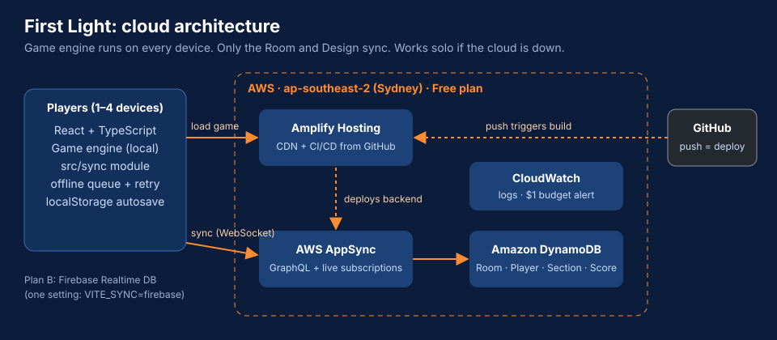

# First Light

A cooperative space mission design game for 1 to 4 players. Build a spacecraft, pick its orbit and rocket, watch the mission fly, and learn why it worked or failed. NASA Space Apps 2026, "Space Mission Design Game" challenge.

**Play:** _live link coming soon_

## Credits

NASA resources used and AI use: [docs/CREDITS.md](docs/CREDITS.md). Not endorsed by NASA.

## Run locally

```bash
npm install
npm run dev
```

Works fully offline (solo, and team mode across browser tabs).

## Game logic

The rules, simulation, scoring and mission report live in `src/engine/` (plain TypeScript, no UI), with all numbers in `src/data/*.json`. Every number names the NASA resource it comes from (mostly CubeSat 101) and is labelled approximate. Guide for the other screens and the score Lambda: [docs/ENGINE.md](docs/ENGINE.md).

```bash
npm test
```

runs the engine tests: the tutorial CubeSat dies 29 minutes into its first eclipse, the fixed craft flies its 3-year mission, live playback matches the replay exactly, and every data file passes its schema.

## Team mode / cloud

- Sync API for game code: [docs/SYNC.md](docs/SYNC.md)
- Backend: AWS Amplify Gen 2 in `amplify/`: AppSync (GraphQL + real-time subscriptions) on DynamoDB, API-key auth so players join without accounts.
- Leaderboard: the `submitScore` mutation runs an AWS Lambda (`amplify/functions/submit-score/`) that replays the flight with the game engine and saves the score it computes, so scores can't be faked. Players can read the Score table but not write to it.
- Hosting: AWS Amplify Hosting builds and deploys backend + frontend on every push to `main` (`amplify.yml`).
- Fallback: set `VITE_SYNC=firebase` and the `VITE_FIREBASE_*` vars (see `.env.example`) to use Firebase Realtime Database instead. If no cloud is reachable the game plays solo.



## Deploy your own (setup)

1. Fork or clone this repo.
2. In the AWS console (region **ap-southeast-2**, Sydney; the AWS Free plan is tied to one region), open **Amplify → Create new app → GitHub**, pick the repo and the `main` branch, keep the defaults and **Save and deploy**. Amplify reads `amplify.yml`, creates the AppSync API and DynamoDB tables from `amplify/data/resource.ts`, then builds and hosts the game.
3. Every push to `main` redeploys. Nothing needs to be installed or configured on your computer.

Local development against AWS (optional): configure AWS credentials, run `npx ampx sandbox` (writes `amplify_outputs.json`), then `npm run dev`. Delete it after with `npx ampx sandbox delete`.

## Project layout

| Path | Owner | What |
|---|---|---|
| `src/sync/` | Member 3 | Multiplayer sync (only import `src/sync/index.ts`) |
| `amplify/` | Member 3 | AWS backend definition |
| `src/engine/`, `src/data/` | Member 1 | Game logic: rules, simulation, events, score, report, team flow ([docs/ENGINE.md](docs/ENGINE.md)) |
| `src/` (rest) | Member 2 | Screens, art and sound |
